# Real EState

https://mahmoudashrafdefmain-pixel.github.io/Real_EState/

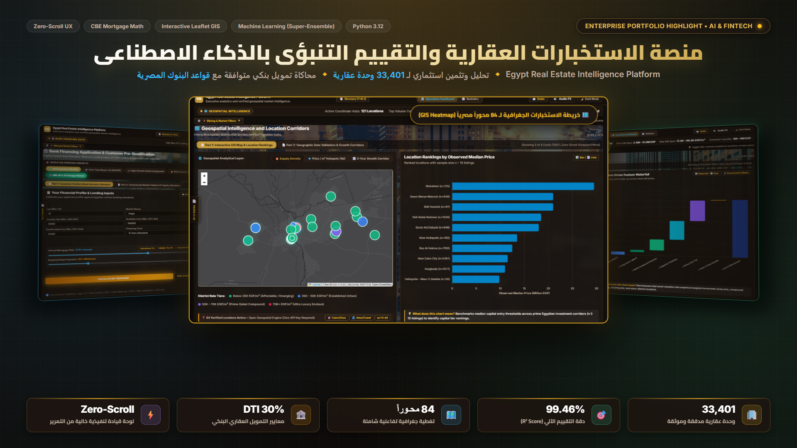

## منصة الاستخبارات العقارية والتقييم التنبؤي بالذكاء الاصطناعي

تحليل وتثمين اكثر من 33000 اصل عقاري مصري مع محرك تمويل بنكي متوافق مع قواعد البنوك المصرية ولوحة تحكم تنفيذية تفاعلية بدون تمرير

هل تساءلت يوما كيف يمكن لقرار استثماري بمليارات الجنيهات في سوق العقارات ان يتحول من مجرد تخمين الى معادلة رياضية رابحة ومحسوبة بدقة عالية

في سوق سريع التغير كالسوق العقاري المصري انطلق هذا المشروع لبناء منصة ذكاء اعمال متكاملة تستند الى دراسة وتدقيق قاعدة بيانات ضخمة تضم 33401 وحدة عقارية عبر مختلف المحافظات

تم اثراء البيانات بمؤشرات جودة الحياة والبيئة عبر دمج مؤشر نقاء الهواء العالمي ونسب المساحات الخضراء

طور محرك تسعير تنبؤي فائق التطور يعتمد على خوارزميات التعلم الالي المركبة محققا دقة 99.46 بالمائة مع نسبة خطأ 2.13 بالمائة

نظام محاكاة ائتماني وتمويلي كامل متوافق مع قواعد البنوك المصرية وسقف عبء الدين لحساب جداول الاهلاك والاقساط الشهرية بدقة بالغة

لوحة تحكم تنفيذية بفلسفة زيرو سكرول ونسبة عرض سبعين بالمائة بصري تفاعلي وثلاثين بالمائة نصوص ورؤى تنفيذية بهوية بصرية فاخرة ودعم الوضع النهاري

خريطة جغرافية تفاعلية مفتوحة المصدر تغطي 84 محورا جغرافيا موثقا

جناح متكامل لاحصاءات ذكاء الاعمال المتقدمة يضم 20 رسما بيانيا ديناميكيا مزودا بشرح فوري لكل رسم

مستكشف حي لقاعدة البيانات مع فلاتر متعددة الابعاد وامكانية تصدير الصفقات الذهبية

## Smart Real Estate Intelligence Platform

How can a complex real estate market be transformed into a data driven investment intelligence system

The Smart Real Estate Intelligence Platform analyzes 33401 property listings and combines pricing and property characteristics with environmental and quality of life indicators to deliver a comprehensive view of the market

Powered by advanced ensemble machine learning models the platform predicts property prices with a reported R squared score of 99.46 percent and provides investment projections and confidence intervals for the next three years

Its integrated financing engine simulates mortgage eligibility debt to income limits repayment schedules and monthly installments while interactive maps cover 84 documented geographic areas

The executive dashboard features 20 dynamic visualizations advanced statistical testing and interactive property exploration with intelligent filters and CSV export for promising investment opportunities

Each property receives a detailed assessment covering fair market value financing eligibility overall quality and projected investment potential

Built with Python Scikit learn LightGBM Pandas NumPy Streamlit Plotly JavaScript Leaflet Chart and Pytest the platform transforms raw real estate data into actionable insights that support smarter investment decisions

## التقنيات المستخدمة

Python Scikit learn LightGBM Pandas NumPy Joblib Leaflet Esri Basemaps HTML CSS JavaScript Chart Streamlit Plotly Pytest

## معرض صور خصائص المنصة

### 01 الموجز التنفيذي لحركة السوق
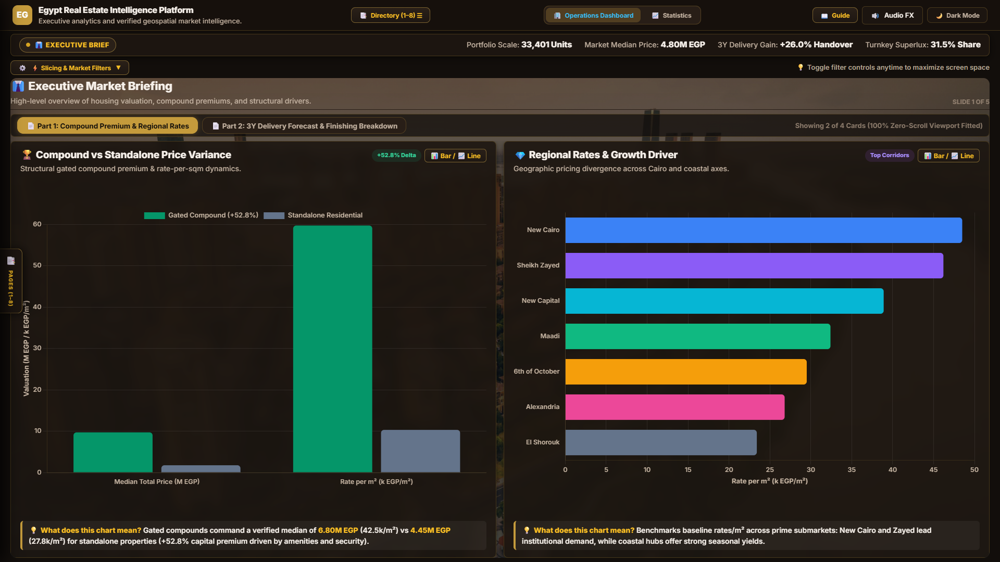

### 02 توقعات التسليم وتوزيع التشطيبات
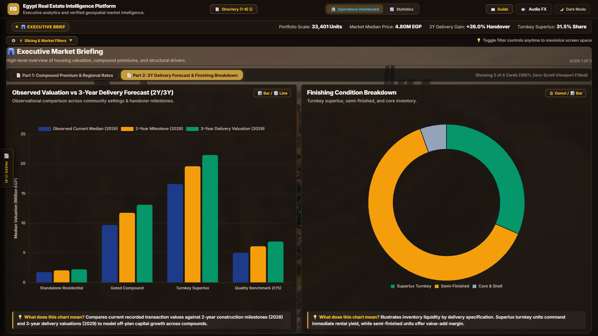

### 03 الخريطة الجغرافية التفاعلية وكثافة المعروض
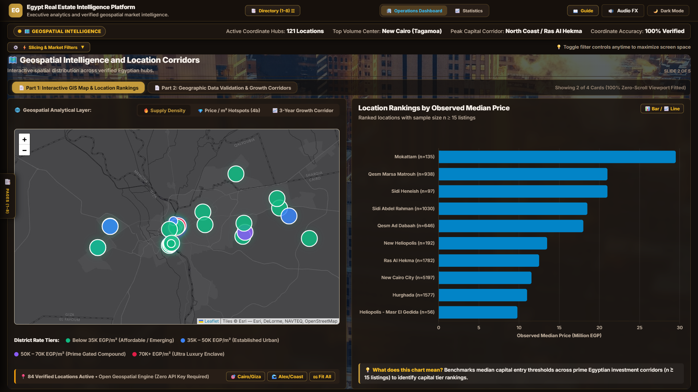

### 04 محاور النمو العقاري والتحقق الجغرافي
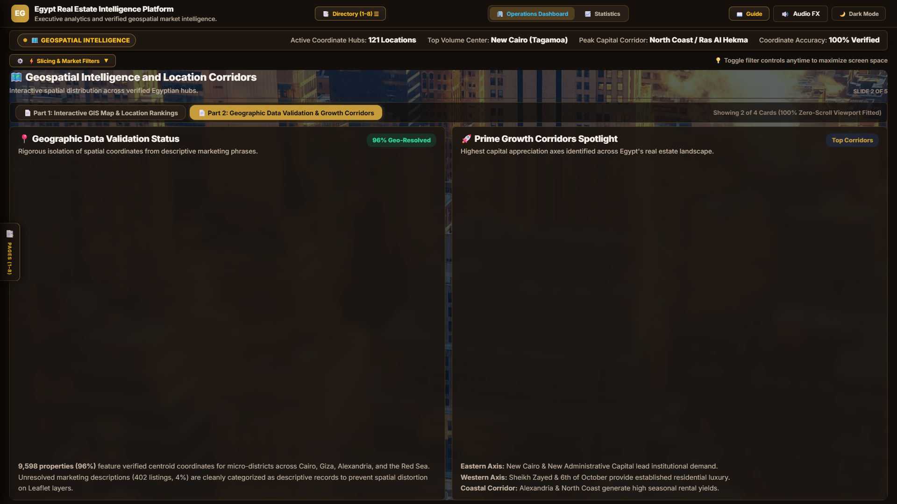

### 05 شلال محركات التقييم والمرونة السعرية
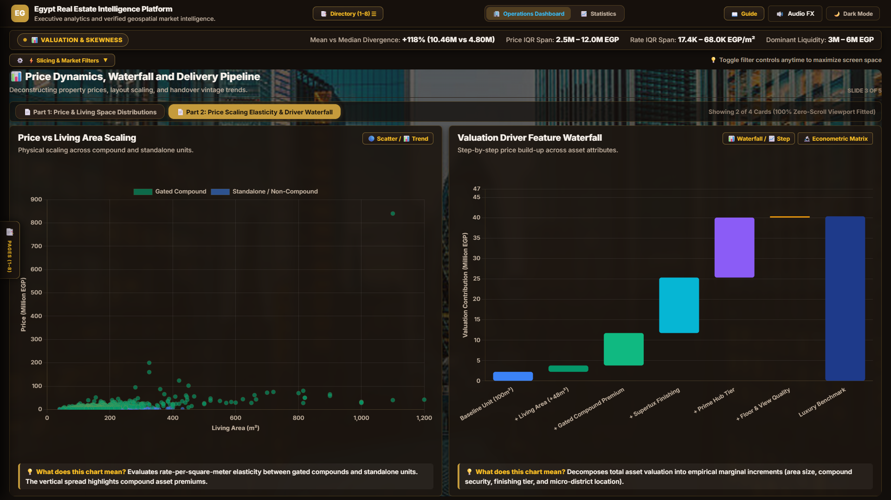

### 06 حاسبة التمويل العقاري والتأهيل البنكي
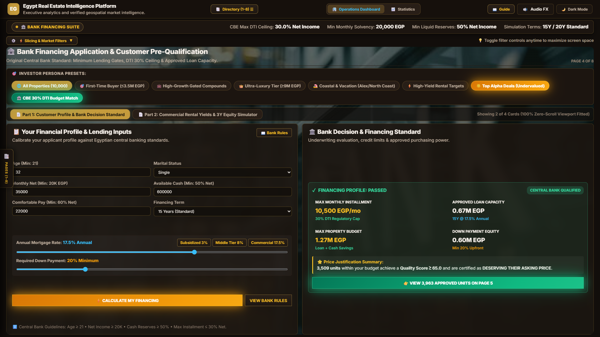

### 07 جدول استهلاك القرض ومحاكي العوائد
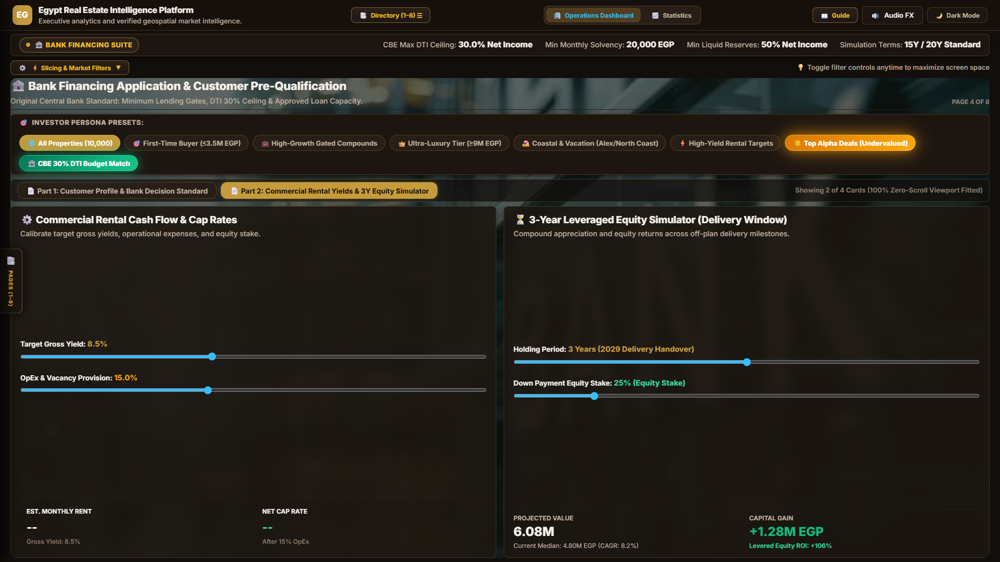

### 08 مصفوفة تقييم الجودة والوحدات المعتمدة
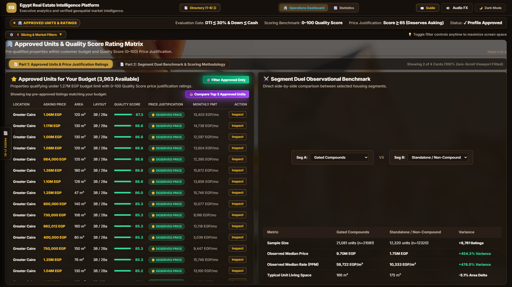

### 09 اقتصاديات السوق وتوزيع الانماط
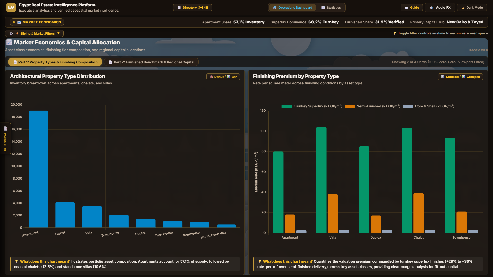

### 10 الابعاد المعمارية ومصفوفة الغرف والحمامات
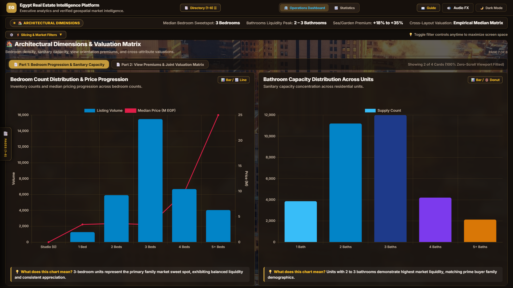

### 11 مستكشف قاعدة البيانات والبحث المتقدم
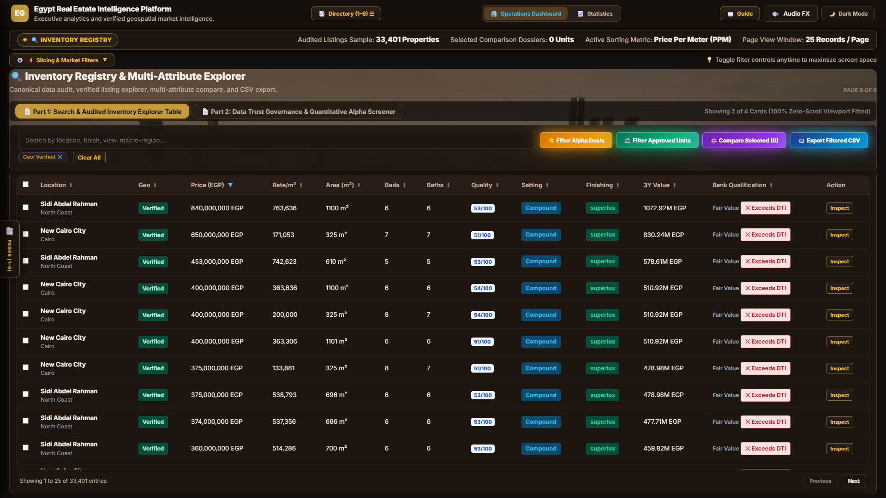

### 12 بطاقة التدقيق الشاملة للعقار
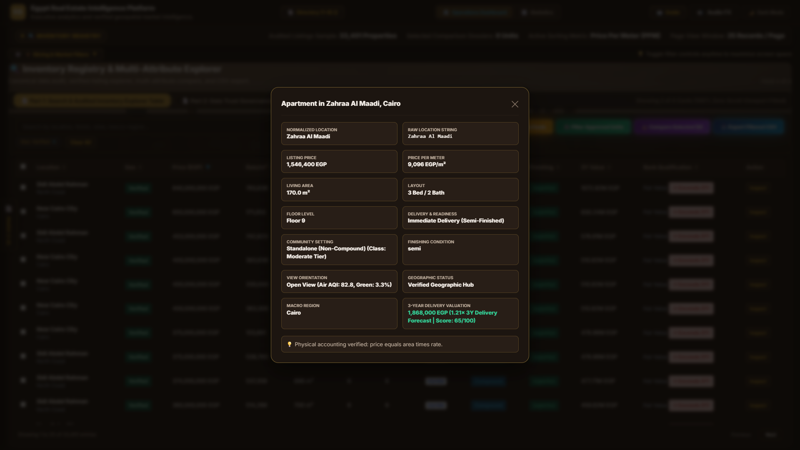

### 13 جناح ذكاء الاعمال ومؤشرات القياس
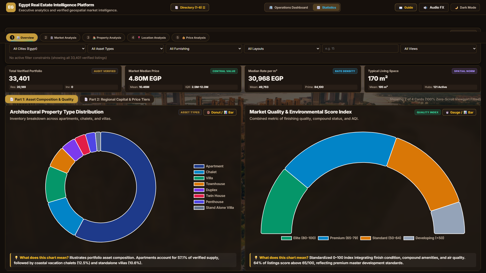

### 14 تحليل المواقع وسعر المتر ونفاذ الكمبوندات
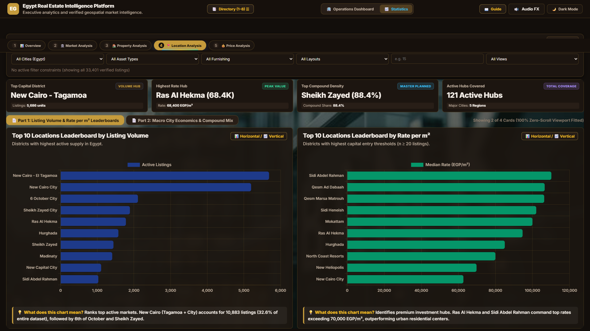

### 15 القياسات الاقتصادية ومخططات التوزيع والتشتت
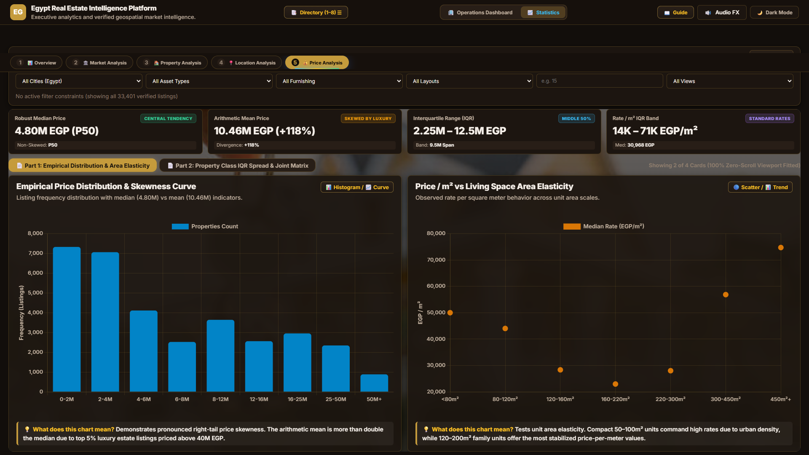
